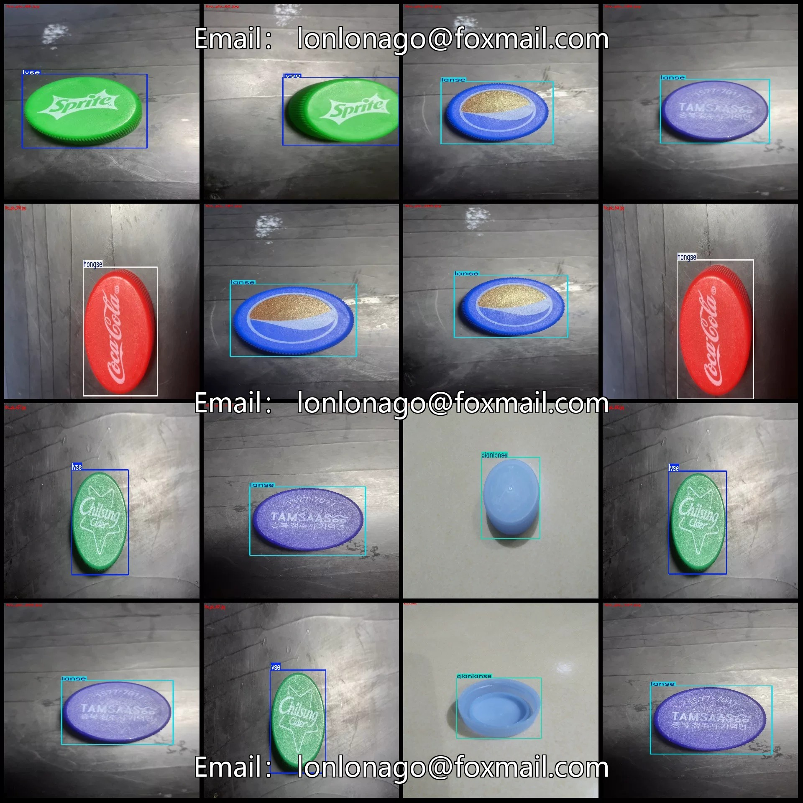
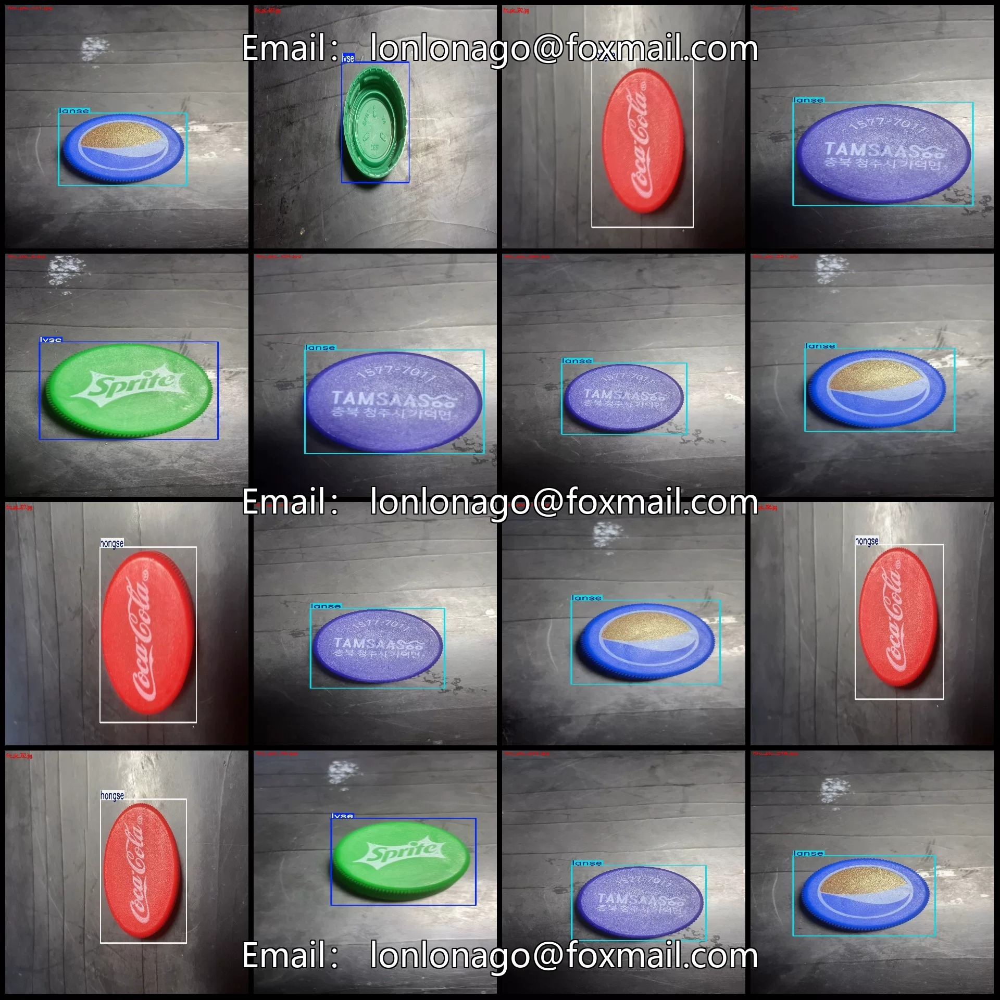
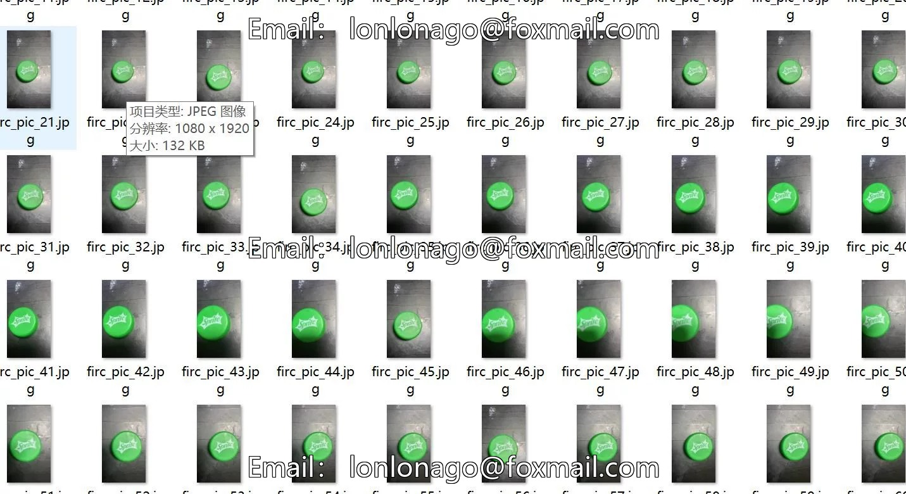
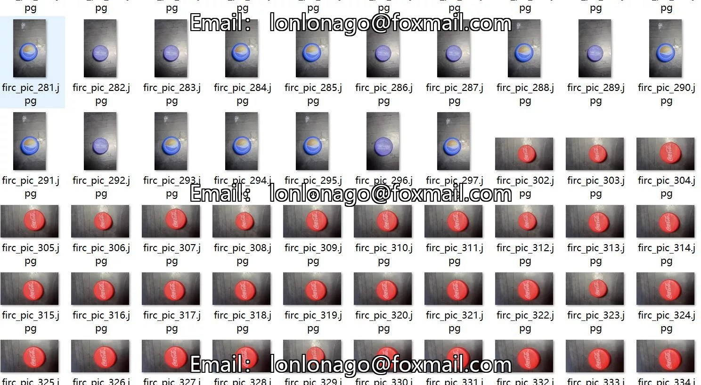
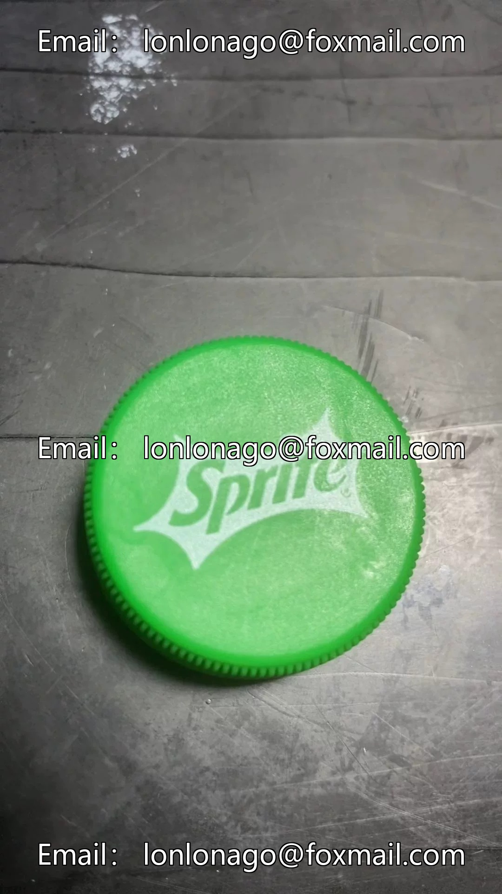
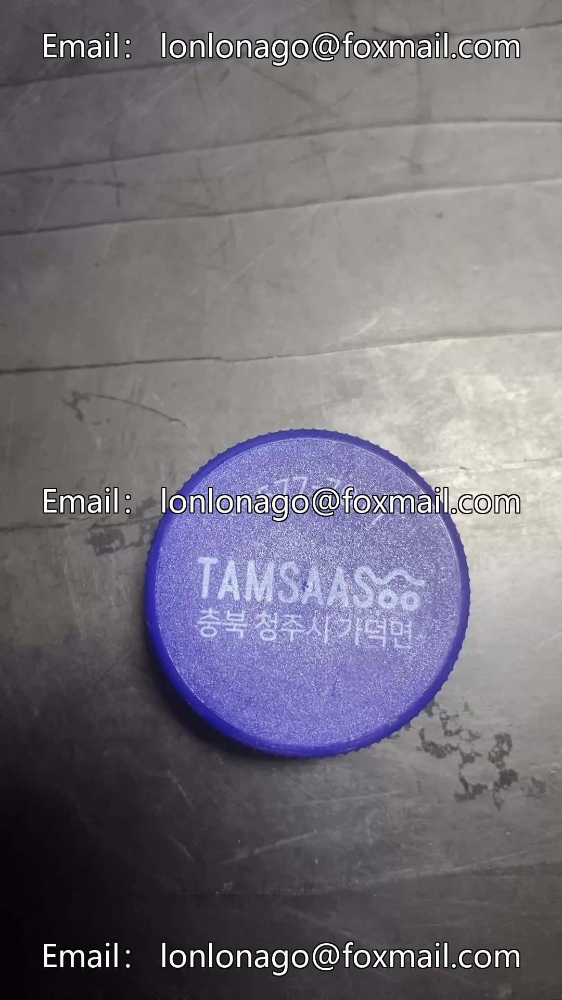
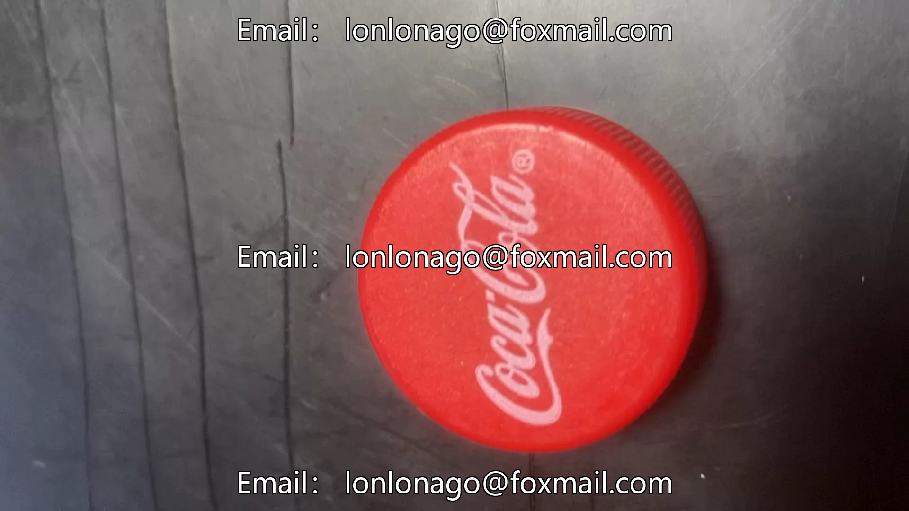

# 514 images in VOC+YOLO format for color detection of bottle caps with 4 categories

## Body

The dataset for color detection of bottle caps in VOC+YOLO format consists of 514 images with 4 categories.

Please note: Since the dataset is reproducible, please confirm that it meets your requirements before purchasing.

Dataset format: Pascal VOC format + YOLO format (txt file without split path, only containing jpg images and corresponding VOC format xml files and yolo format txt files)
Number of images (number of jpg files): 514
Number of annotations (number of xml files): 514
Number of annotations (number of txt files): 514
Number of annotation categories: 4

Annotation categories: ["hongse", "lanse", "lvse", "qianlanse"]
Each category has a number of bounding boxes and the number of images they occupy.
hongse = 100 bounding boxes, 100 images occupied
lanse = 211 bounding boxes, 211 images occupied
lvse = 185 bounding boxes, 185 images occupied
qianlanse = 18 bounding boxes, 18 images occupied
Total bounding boxes: 514

Image resolution: Multi-resolution images, such as 1080x1920, 1920x1080, etc.
Using labeling tool: labelImg
Labeling rules: Draw a rectangle around the category
Important note: The dataset does not have separate training, validation, and test sets; you need to partition them yourself.
Special declaration: This dataset does not guarantee the accuracy of the trained models or weight files.

## Images

## Payment

Here is a pay link on Stripe ( https://buy.stripe.com/3cs8yP7sY87d0vu9AB ). Please contact me lonlonago@foxmail.com after funding $89, and I will send you a complete data files , thank you!

